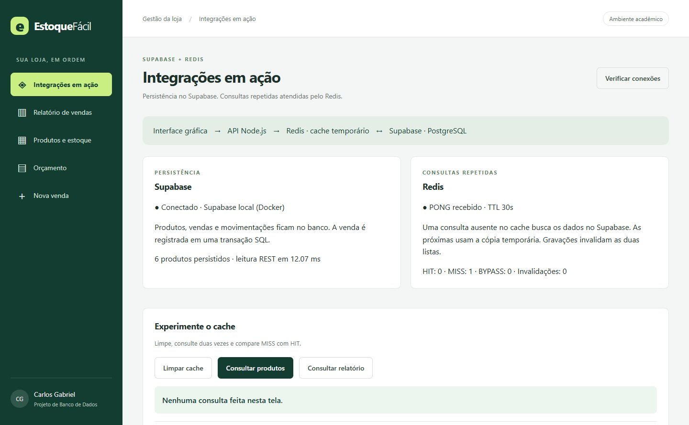
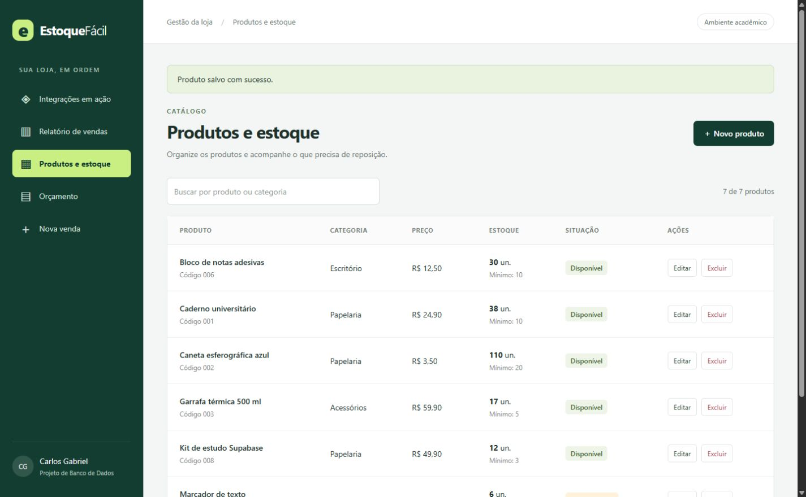
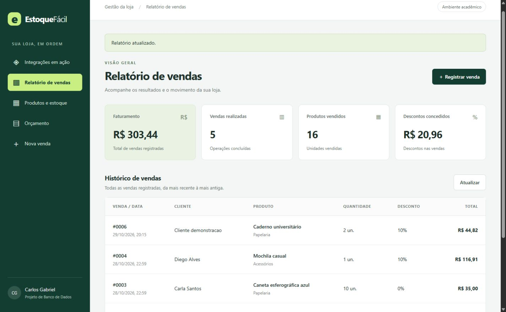

# Estoque Fácil — Supabase + Redis

Sistema de estoque e vendas para pequenas lojas: reúne produtos, quantidades e histórico, evitando controles manuais separados. Esta versão evolui o trabalho anterior com Supabase real para persistência e Redis real para cache de consultas.

- Aluno: Carlos Gabriel Raposo Landim
- Disciplina: Projeto de Banco de Dados — 26/2
- Professor: Anderson Soares
- Trabalho individual: Integração com Supabase e Redis — 29/10/2026
- [Código desta entrega](https://github.com/karlitus222/estoque-facil/tree/trabalho-supabase-redis)
- [Vídeo e pacote completo](https://github.com/karlitus222/estoque-facil/releases/tag/supabase-redis-2026-2)

## Objetivo e funcionalidades

Cadastrar, editar, consultar e excluir produtos sem vendas; acompanhar estoque mínimo; calcular orçamentos com desconto; registrar vendas e consultar relatórios. O painel **Integrações em ação** verifica a Data API do Supabase e mostra conexão, chaves, TTL, contadores e origem de cada consulta no Redis.

Cada venda contém um produto e uma quantidade. Os clientes de exemplo são fictícios. Não há carrinho, pagamentos ou emissão fiscal.

## Tecnologias

Node.js 22+, Express, HTML/CSS/JavaScript, PostgreSQL 17 do Supabase, `pg`, `@supabase/supabase-js`, Redis 7.4 e cliente `redis`. Dependências fixadas no lockfile. Docker Desktop executa o ambiente local oficial do Supabase e o Redis. PGlite permanece para testes isolados herdados; o servidor desta versão exige Supabase.

```text
Navegador → Express em 127.0.0.1:3012
             ├─ consulta de produtos/relatório → Redis
             │    ├─ HIT: cópia temporária
             │    └─ MISS/BYPASS: PostgreSQL do Supabase
             ├─ gravação → PostgreSQL → invalidação do cache
             └─ diagnóstico → Data API via supabase-js
```

## Instalação, configuração e execução

Requisitos: Git, Node.js 22+ com npm e Docker Desktop com engine Linux iniciada. A primeira instalação precisa de internet para baixar dependências e imagens. A demonstração usa Node 24. Reserve memória e espaço para o conjunto de serviços do Supabase.

```sh
git clone --branch trabalho-supabase-redis https://github.com/karlitus222/estoque-facil.git
cd estoque-facil
npm ci
npm run supabase:start
npm run redis:start
npm run local:config
npm start
```

Abra **http://127.0.0.1:3012**. Se o PowerShell bloquear `npm.ps1`, use `npm.cmd` nos mesmos comandos. Não é necessária conta Supabase: a entrega usa o ambiente local oficial, com PostgreSQL e Data API reais. Studio: `http://127.0.0.1:54323`.

`local:config` obtém a configuração da CLI e cria `.env` sem imprimir credenciais; preserva um arquivo existente. `.env.example` documenta `PORT`, `SUPABASE_URL`, `SUPABASE_DB_URL`, `SUPABASE_SECRET_KEY`, `REDIS_URL` e `CACHE_TTL`. Nunca envie a chave do servidor ao navegador ou ao GitHub.

Portas: 3012 (app), 54321 (API), 54322 (PostgreSQL), 54323 (Studio) e 6387 (Redis). Em caso de conflito, ajuste `supabase/config.toml`, `compose.redis.yaml` e `.env` de forma correspondente. O script usa 3012/6387 como padrões.

A migração em `supabase/migrations` recria o esquema. Na primeira inicialização, o app instala seis produtos e quatro vendas fictícias uma única vez, controlado por `controle_banco`. Depois preserva os dados. As datas iniciais correspondem ao momento da instalação. Não execute `supabase db reset` sobre dados que queira manter.

Pare o app com Ctrl+C. Para parar serviços preservando o banco:

```sh
docker compose -f compose.redis.yaml stop
npx supabase stop
```

Para retornar, execute `supabase:start`, `redis:start` e `npm start`. O Redis não persiste dados: seu conteúdo é reconstruído do Supabase. O antigo `compose.yaml` pertence à primeira versão e não é usado nesta entrega.

## Integração com Supabase

Produtos, vendas e movimentações ficam no PostgreSQL do Supabase. As rotas usam `pg`, consultas parametrizadas e transações. A procedure `registrar_venda` bloqueia a linha com `FOR UPDATE`, confere saldo, calcula desconto pela function `calcular_total`, registra venda/movimentação e baixa estoque na mesma transação. Falhas causam rollback. O relatório consulta a view `relatorio_vendas`.

`src/supabase.js` também usa `supabase-js` para consultar a Data API: conta produtos e lê cinco registros. Essa amostra aparece no painel e não passa pelo cache, comprovando a comunicação e permitindo conferir o saldo persistido.

`banco/seguranca.sql` habilita RLS, restringe `anon`/`authenticated`, usa view `security_invoker` e fixa `search_path` das rotinas. A chave privilegiada permanece no servidor. O app acadêmico escuta em loopback e não tem login; não deve ser exposto diretamente à internet. Produção exigiria autenticação, autorização, conta SQL com privilégios mínimos e backups.

## Uso e justificativa do Redis

Listas de produtos e relatórios são lidas repetidamente entre alterações. Redis mantém essas respostas em memória durante **30 segundos**, reduzindo consultas e agregações no banco. Foi escolhido pelo acesso por chave, expiração nativa e operações atômicas. Uma requisição local isolada pode não ficar mais rápida; o benefício principal é evitar trabalho repetido no banco.

| Evento | Comportamento |
| --- | --- |
| MISS | Consulta Supabase e salva resposta com TTL |
| HIT | Usa cópia válida do Redis |
| Cadastro, edição, exclusão ou venda | Invalida produtos e relatório após confirmar a gravação |
| Expiração | A próxima leitura consulta Supabase |
| Falha do Redis | BYPASS: consulta direta ao Supabase |
| Reconexão | Descarta cópias antigas antes de reutilizar o cache |

Chaves: `estoque:v2:produtos`, `estoque:v2:relatorio` e `estoque:v2:geracao`. A geração muda junto à invalidação em uma operação `MULTI`. Um script Lua só publica o resultado de uma consulta se a geração ainda for a mesma, impedindo que uma leitura anterior à gravação reponha cache antigo. TTL `-2` significa chave ausente.

Redis nunca decide se há saldo para vender. Orçamento e gravações consultam o banco. Falha de invalidação não transforma venda já confirmada em erro; a reconexão limpa cópias. Contadores são locais ao processo Node e zeram ao reiniciar.

Limites: validado para uma instância do app, sem promessa de consistência distribuída durante falhas entre vários servidores. Alterações diretas no banco podem levar até o TTL para aparecer nas listas. As duas listas expiram; a geração não. Redis tem limite de 64 MB e política `allkeys-lru`.

## Telas e vídeo

[Vídeo demonstrativo na release](https://github.com/karlitus222/estoque-facil/releases/tag/supabase-redis-2026-2). Mostra captura da aplicação funcionando: cadastro, consulta real ao Supabase, MISS/HIT, venda, relatório e falha/retorno do Redis. A narração é sintetizada em português; as telas e resultados vêm do sistema em execução.





Roteiro reproduzível:
1. Em Integrações em ação, limpe o cache e consulte produtos duas vezes: MISS e HIT.
2. Cadastre um produto e registre uma venda.
3. Confira o relatório e a amostra direta do Supabase.
4. Pare apenas Redis: `docker compose -f compose.redis.yaml stop redis`.
5. Consulte no painel: BYPASS. Execute `npm run redis:start`, verifique conexões e consulte novamente: MISS e HIT.

## Testes

```sh
npm test
npm run test:integracao
```

`npm test` usa testes isolados de SQL/API e o cenário de cache indisponível. Dois testes que exigem serviços reais são ignorados quando faltam as variáveis. `test:integracao` carrega `.env` e exige Supabase/Redis rodando; execute depois que `npm start` preparar a instalação. Cria seu próprio produto fictício e limpa apenas seus registros, com prefixo Redis exclusivo.

Suíte inteira com ambiente preparado:

```sh
node --env-file=.env --test --test-concurrency=1
npx supabase db advisors --local --type security --level warn --fail-on warn
npm audit
```

Cobertura: CRUD, valores monetários, venda atômica, saldo insuficiente, concorrência, histórico, persistência, Data API, MISS/HIT, invalidação, expiração, corrida consulta/gravação, RLS e continuidade sem Redis. [Detalhes da validação](docs/testes.md).

## Estrutura

- `src/servidor.js`: inicialização e encerramento.
- `src/rotas.js`: API e invalidação após gravações.
- `src/cache.js`: cache, TTL, geração e fallback.
- `src/supabase.js`: Data API real.
- `src/publico/`: interface e diagnóstico.
- `banco/`: tabelas, function, procedure, view e segurança.
- `supabase/`: configuração e migração.
- `compose.redis.yaml`: Redis desta versão.
- `tests/`: testes isolados e integração real.

[Diagrama do banco](docs/banco.md). Referências: [Supabase local](https://supabase.com/docs/guides/local-development/cli/getting-started), [conexão PostgreSQL](https://supabase.com/docs/guides/database/connecting-to-postgres), [Redis para Node.js](https://redis.io/docs/latest/develop/clients/nodejs/).
